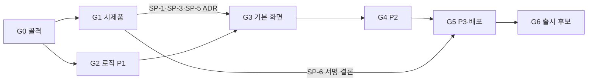

# 11. 구현 작업 목록 (백로그)

j-zip 구현 작업을 단계(G0–G6)별로 나누고, 작업 사이의 순서와 선행 관계를 정한다.
작업 ID·단계·완료 정의는 [09. 구현 절차](09-development-process.md), 증거 종류(E1–E10)는 [10. 로그·증거·운영](10-logging-evidence-operations.md)을 따른다.

이 목록은 **대략적인 계획**이다. planner 에이전트는 이 목록에서 작업 카드(`work/tasks/<작업 ID>.md`)를 만들면서 범위를 확정한다. 크기가 L인 작업은 카드를 만들 때 PR 하나 크기(변경 400줄 이하)로 다시 나눈다.

## 읽는 법

| 열 | 뜻 |
|---|---|
| ID | `^G[0-6]-(F\d{2}\|SP\d\|INFRA\|OPS\|CLEANUP\|UPSTREAM)-T\d{2}$` ([09](09-development-process.md) 4절) |
| 근거 | 기능 명세 FR, 게이트 항목(`09 3.2 #n`), 화면 요소 ID |
| 선행 | 이 작업을 시작하기 전에 병합되어 있어야 하는 작업. `—`는 단계 진입 조건만 필요 |
| 크기 | S = 반나절 이하 · M = PR 하나 · L = 카드 생성 시 분할 |
| 증거 | 필수 증거 종류([10](10-logging-evidence-operations.md) 3.2). 모든 작업에 E9(검토 기록)가 추가로 붙는다 |

---

## 1. 전체 흐름



- **G1과 G2는 병렬로 진행할 수 있다.** 둘 다 G0만 필요하다. G2의 진입 조건은 CLI 스위치 이름 ADR(`G2-INFRA-T01`)이다.
- G3은 G2의 로직과 G1의 시제품 결론(셸 등록 SP-1, 실행 인자·단일 인스턴스 SP-3, 확장자 등록 SP-5)이 모두 필요하다.
- 서명 조사(SP-6)는 G1에서 끝내 두고, 실제 서명 적용은 G5에서 한다.
- 7-Zip 업스트림 갱신(`G<n>-UPSTREAM-T<nn>`)은 새 정식 버전이 나올 때 다음 단계 시작 전에 끼워 넣는다([09](09-development-process.md) 10절). 이 목록에는 미리 넣지 않는다.

### 1.1 핵심 경로

전체 일정을 결정하는 가장 긴 선행 사슬이다(선행 관계로 이어지는 작업 14개, 각 단계 정리 작업 포함). 이 경로의 작업이 늦어지면 출시가 늦어진다.

```
G0-INFRA-T01 레포 골격
 → G0-INFRA-T02 빌드 스크립트·솔루션
 → G0-INFRA-T11 jzip-shared·jzip-win 연결
 → G0-INFRA-T14 WinUI 3 빈 앱 + MSIX 뼈대
 → G1-SP1-T01 셸 등록 시제품
 → G3-F19-T01 MSIX 셸 등록
 → G3-F18-T01 셸 메뉴 모델
 → G3-INFRA-T06 설치→우클릭→풀기→알림 전체 흐름 증거
 → G4 … → G5-F27-T02 서명 → G5-F27-T03 Store 제출 → G6
```

로직 쪽 사슬(`G0-INFRA-T11 → G2-INFRA-T04 → G2-F13-T02 → G3-F13-T04`)은 이보다 짧다. 그래서 로직 작업이 늦어져도 셸·패키징 사슬이 막히지 않는 한 전체 일정에는 여유가 있다.

---

## 2. G0 골격

게이트: [09](09-development-process.md) 3.2의 항목 1–10. 도구 작업 번호(T02, T04–T10)는 09 11절 도구 계약 표와 같다.

| ID | 작업 | 근거 | 선행 | 크기 | 증거 |
|---|---|---|---|---|---|
| G0-INFRA-T01 | 레포 골격: 폴더 구조, 7-Zip 26.04 subtree(`upstream/7zip`), `upstream/PATCHES.md`, `third_party/VERSIONS.md`, `THIRD_PARTY_NOTICES.md` 초안 | 09 2절 | — | S | E1 |
| G0-INFRA-T02 | `tools/build.ps1` + `jzip.sln` + 빌드 구성 4종(Debug·Dev·Test·Release), nmake 호출 래핑, `out/runlog.jsonl` 기록 | 09 3.2 #1·#4, 09 11절, 07 5절 | T01 | M | E1 |
| G0-INFRA-T03 | CI 워크플로: `windows-2025`(VS 2026)·`windows-2022`·`windows-11-arm`, ARM 불가 시 교차 컴파일, 작업 단위 경로 필터(성공 보고), 아티팩트 `retention-days: 90` | 09 7절, 07 8절 | T02 | M | E1 |
| G0-INFRA-T04 | GoogleTest(vcpkg 기준선 고정) + `tests/unit/run.ps1` | 09 11절 | T02 | S | E1, E2 |
| G0-INFRA-T05 | 코퍼스 v0 생성기 `tests/corpus/generate.ps1` + 통합 테스트 실행기 `tests/integration/run.ps1`, 원본 `7z.exe` 기준선 통과 | 09 3.2 #1·#6 | T02 | M | E1, E3 |
| G0-INFRA-T06 | 로그 뼈대: `ILogger` 포트, `JZ_LOG_*`·`JZ_DEV_TRACE`(`JZDEV\|` 표식) 매크로, 바이너리별 ETW 공급자(GUID 고정), `EVENTS.md`, `trace-start/stop.ps1` | 09 3.2 #7, 10 2절 | T11 | M | E1, E4 |
| G0-INFRA-T07 | 증거 도구: `new-manifest.ps1`, CI의 `JZIP-VERIFY` 댓글 반영 봇, PR별 `evidence-pr-<번호>.zip`을 초안 릴리스 `gate-G<n>`에 첨부 | 10 3.3, 09 11절 | T03 | M | E1 |
| G0-INFRA-T08 | `capture-window.ps1`(대화형 세션 검사, 축소 PNG 200KB 이하) + 대화형 러너 준비 문서 | 10 3.1 E5 | T01 | S | E5 |
| G0-INFRA-T09 | 성능 테스트 뼈대 `tests/perf/run.ps1` | 09 11절 | T04 | S | E8 |
| G0-INFRA-T10 | 게이트 스크립트 `check-task.ps1`·`check-stage.ps1`(임시 표시, 구성 정의, 바이너리 `JZDEV\|` 검사, PATCHES 대조, 이벤트 목록 대조) | 09 3.2 #10, 10 4·5절 | T06, T07 | M | E1 |
| G0-INFRA-T11 | `jzip-shared`·`jzip-win` 빈 라이브러리 두 변형(`-mt`·`-md`), nmake 변수 `JZIP_SHARED_LIB`·`JZIP_WIN_LIB`로 `7z.dll`·`7z.exe` 링크, 플래그 계약 | 09 3.2 #2·#3, 07 5절 | T02 | M | E1 |
| G0-INFRA-T12 | 빈 `jzip-shell.dll` + CI 셸 링크 검사(`jzip-core`·WinRT 금지) | 09 3.2 #5 | T03, T11 | S | E1 |
| G0-INFRA-T13 | ADR: MSIX 앱에서 WER LocalDumps 실측 | 09 3.2 #8 | T14 | S | E10 |
| G0-INFRA-T14 | WinUI 3 빈 앱(`JZip.exe`) + MSIX 패키징 뼈대 + ADR: 템플릿의 C++/WinRT 버전 | 09 3.2 #9, 07 3절 | T02 | M | E1, E7 |
| G0-INFRA-T15 | 템플릿: 작업 카드, PR(증거 섹션), ADR, `JZIP-VERIFY` 댓글 형식 | 09 4·7·9절 | T01 | S | E1 |
| G0-CLEANUP-T01 | G0 단계 종료 정리 + `check-stage -Stage G0` | 10 5절 | G0의 다른 모든 작업 | S | E1 |

병렬 묶음: `T03`·`T04`·`T05`·`T11`·`T14`·`T15`는 `T02`(T15는 T01) 이후 동시에 진행할 수 있다.

---

## 3. G1 시제품

모든 시제품은 `spikes/<SP 번호>/`에서 만들고 결론을 ADR로 남긴다. 필수 증거는 [10](10-logging-evidence-operations.md) 3.2 "시제품" 행을 따른다.

| ID | 작업 | 근거 | 선행 | 크기 | 증거 |
|---|---|---|---|---|---|
| G1-SP1-T01 | 셸 등록: MSIX `comServer` + `windows.fileExplorerContextMenus`로 Win11 새 메뉴 표시, Win10 22H2·Win11 "추가 옵션 표시" 동작, 셸 실행 프로세스·패키지 ID, PFN 결정 경로(`source`) 로그, VS 느슨한 배포 확인 | 07 9절, 08 6절 | G0-INFRA-T12, G0-INFRA-T14 | M | E4, E5, E7 + ADR |
| G1-SP2-T01 | 10만 항목 목록 가상화 성능(스크롤·정렬) | 07 9절 | G0-INFRA-T14, G0-INFRA-T09 | M | E8 + ADR |
| G1-SP2-T02 | SP-2 측정 하네스를 `tests/perf/`로 승격 | 10 1절 | G1-SP2-T01 | S | E8 |
| G1-SP3-T01 | 실행 인자 `--proto 1`, 임시 목록 파일(`%TEMP%` 가상화 여부), 단일 인스턴스·같은 창 탭 전달 | 08 5절 | G0-INFRA-T14 | M | E4 + ADR |
| G1-SP4-T01 | 관리자 권한 실행 시 앱 알림 실패 확인과 대체 동작 | 07 9절, F32 | G0-INFRA-T14 | S | E4 + ADR |
| G1-SP5-T01 | `uap:FileTypeAssociation` 40개 이상 등록 시 설치·기본 앱 후보 동작 | 07 9절, F27 | G0-INFRA-T14 | S | E4, E7 + ADR |
| G1-SP6-T01 | 서명 인증서(Azure Trusted Signing 등) 자격·비용 조사 | 07 9절 | — | S | 조사 노트 + ADR |
| G1-CLEANUP-T01 | `spikes/` 삭제(태그 `spike/<SP>-final`), 정리 + `check-stage -Stage G1` | 10 5절 | G1의 다른 모든 작업 | S | E1 |

병렬 묶음: SP-1~SP-5는 G0-INFRA-T14 이후 동시에 진행할 수 있고, SP-6은 언제든 시작할 수 있다.

---

## 4. G2 로직 P1

진입 조건: `G2-INFRA-T01`(CLI 스위치 이름 ADR) 채택. 증명 대상은 각 명세의 `[로직]` 수용 기준이다.

### 4.1 공통 기반

| ID | 작업 | 근거 | 선행 | 크기 | 증거 |
|---|---|---|---|---|---|
| G2-INFRA-T01 | ADR: CLI 스위치 이름(F13 FR-13-12 스마트 해제, F31 FR-31-10 해제 후 휴지통) | 09 3.1 | — | S | ADR |
| G2-INFRA-T02 | 설정 스키마(`Area.Key`, `pii`, 버전·마이그레이션) + JSON 파서 (`jzip-shared`) | 08 2·6절 | G0-INFRA-T11 | M | E1, E2 |
| G2-INFRA-T03 | 설정 서비스(`jzip-core`, 주입된 폴더) + 쓰기 규칙(뮤텍스·병합·원자적 교체·재시도·`Result`) + `jzip-win` 공유 읽기 + `ZipRegistry` 어댑터 패치(`JZIP-PATCH`) | 08 6절 | G2-INFRA-T02 | L | E1, E2 |
| G2-INFRA-T04 | 엔진 어댑터 + `Operation`·`OperationRunner`(대기열·취소·진행 싱크) 뼈대 | 08 2·3절 | G0-INFRA-T11 | L | E1, E2 |

### 4.2 기능 로직

| ID | 작업 | 근거 | 선행 | 크기 | 증거 |
|---|---|---|---|---|---|
| G2-F17-T01 | 코드페이지 변환기(`jzip-win/locale`, `MB_ERR_INVALID_CHARS`, OEM/ACP 조회) | F17 7절 | G0-INFRA-T11 | S | E1, E2 |
| G2-F17-T02 | 후보별 바이트 유효성 검사(1단계) | F17 FR-17-4·5 | G2-F17-T01 | M | E1, E2 |
| G2-F17-T03 | 인코딩 후보 점수 계산(UTF-8 우선, 그럴듯함, CP949/GBK 겹침, 동점·확신 부족) — [09](09-development-process.md) 4절 예시 카드 | F17 FR-17-6~12 | G2-F17-T02 | M | E1, E2, E3 |
| G2-F17-T04 | `ZipItem`·`ZipHandler` 연결 패치: 이름 결정 순서(FR-17-13), Unix 규칙 처리, 항목별 UTF-8 예외, `cp` 속성 | F17 FR-17-13~16 | G2-F17-T03 | M | E1, E2, E3 |
| G2-F17-T05 | ZIP 주석도 같은 코드페이지 적용(`CP_ACP` 고정 버그) | F17 FR-17-16, F16 | G2-F17-T04 | S | E2, E3 |
| G2-F17-T06 | 한·중·일 코퍼스 확장과 기준값 조정, 결과 표 | F17 8절 [로직] | G2-F17-T04, G0-INFRA-T05 | M | E3 |
| G2-F12-T01 | tar 한 번에 풀기 판정 규칙(`jzip-shared`) | F12 | G0-INFRA-T11 | S | E2 |
| G2-F12-T02 | Gz·Bz2·Xz·Zstd 핸들러 `kpidMainSubfile` 패치 + 옵션 연결 | F12 7절 | G2-F12-T01 | M | E1, E2, E3 |
| G2-F12-T03 | CLI 동작과 코퍼스(`.tgz`·`.tar.xz`·`.tzst` 등) | F12 8절 [로직] | G2-F12-T02 | S | E3 |
| G2-F13-T01 | 스마트 해제 계획(`jzip-shared`: 최상위 항목 판정, 경로 계산, 충돌 정책) | F13 | G0-INFRA-T11 | M | E1, E2 |
| G2-F13-T02 | `Extract.cpp` 연결 패치 + `jzip-win` 파일 시스템 확인 | F13 7절 | G2-F13-T01, G2-INFRA-T04 | M | E1, E2, E3 |
| G2-F13-T03 | CLI 스위치(ADR 이름) + 코퍼스 | F13 FR-13-12, 8절 [로직] | G2-F13-T02, G2-INFRA-T01 | S | E3 |
| G2-F35-T01 | 여러 아카이브 각각 폴더로 + 스마트 규칙 결합 | F35 | G2-F13-T02 | S | E2, E3 |
| G2-F30-T01 | 해제 후 폴더 열기 실행 조건(오류·경고 시 생략 등) 규칙 | F30 | G2-INFRA-T04 | S | E2 |
| G2-F31-T01 | 휴지통 구현(`jzip-win`, 자체 STA 스레드, 휴지통 불가 위치 판별) + COM 미초기화·MTA 스레드 테스트 | F31 7절 | G0-INFRA-T11 | M | E1, E2 |
| G2-F31-T02 | 실행 조건(FR-31-3~5) 규칙(`jzip-shared`) | F31 | G0-INFRA-T11 | S | E2 |
| G2-F31-T03 | `Extract()` 연결 패치 + CLI 스위치 + 코퍼스 | F31 FR-31-10, 8절 [로직] | G2-F31-T01, G2-F31-T02, G2-INFRA-T04, G2-INFRA-T01 | M | E3, E6 |
| G2-CLEANUP-T01 | G2 정리 + `check-stage -Stage G2` | 10 5절 | G2의 다른 모든 작업 | S | E1 |

병렬 묶음: F17 사슬, F12 사슬, F13 사슬, F31 사슬은 서로 독립이라 동시에 진행할 수 있다(모두 `G0-INFRA-T11`만 공통 선행).

---

## 5. G3 기본 화면

진입 조건: G2 게이트 통과 + G1의 SP-1·SP-3·SP-5 ADR 채택.

### 5.1 앱 기반

| ID | 작업 | 근거 | 선행 | 크기 | 증거 |
|---|---|---|---|---|---|
| G3-INFRA-T01 | `JZip.exe` 기반: 화면 경로 표, MVVM 뼈대, PresentationModel 연결, 문자열 조회 계층(기본 내장 문자열) | 08 2·4절 | G2-INFRA-T03 | M | E1, E2 |
| G3-INFRA-T02 | 디자인 토큰(ThemeDictionaries)과 컴포넌트 C01–C22 XAML 스타일 | 06 3·4절, 04 | G3-INFRA-T01 | L | E5 |
| G3-INFRA-T03 | 실행 인자 프로토콜 `--proto 1` + 단일 인스턴스(SP-3 결론) | 08 5절 | G3-INFRA-T01, G1-SP3-T01 | M | E2, E4 |
| G3-INFRA-T04 | 작업 실행기 ↔ 뷰모델 연결(진행 이벤트, UI 스레드 전달, 취소) | 08 2절 | G3-INFRA-T01, G2-INFRA-T04 | M | E2 |
| G3-INFRA-T05 | 포맷 정보 표 `formats.def` + 매니페스트 `FileTypeAssociation`·S2-08 목록 생성 + CI의 `7z i` 대조 | 08 4절 | G0-INFRA-T11, G1-SP5-T01 | M | E1, E7 |
| G3-F27-T01 | MSIX 패키지 x64·ARM64·번들, 실행 별칭 `jzip`, 최소 OS 19045 | F27 G3 FR | G0-INFRA-T14, G3-INFRA-T05 | M | E1, E7 |

### 5.2 화면

| ID | 작업 | 근거 | 선행 | 크기 | 증거 |
|---|---|---|---|---|---|
| G3-F10-T01 | S1 메인 창: 툴바, 경로 줄, 폴더 트리(신규), 파일 목록(SP-2 결론), 상태 줄 | F10, 06 S1 | G3-INFRA-T02, G3-INFRA-T04, G1-SP2-T01 | L | E2, E5 |
| G3-F14-T01 | S1 파일 추가·삭제(풀지 않고 수정) | F14 | G3-F10-T01 | M | E2, E3, E5 |
| G3-F17-T07 | S1-12 인코딩 칩 + S5 화면(후보·미리보기·적용 시 다시 열기) + S2-10 | F17 [화면], 06 S5 | G3-F10-T01, G2-F17-T04 | M | E2, E5 |
| G3-F13-T04 | S2 압축 풀기: 위치·빠른 선택, 폴더 만들기, 결과 미리보기, 같은 파일 처리 | F13 [화면], 06 S2 | G3-INFRA-T02, G2-F13-T02 | M | E2, E5 |
| G3-F12-T04 | S2-08 ".tar.gz 등을 한 번에 풀기" 표시 조건 | F12 [화면] | G3-F13-T04, G3-INFRA-T05 | S | E5 |
| G3-F30-T02 | S2-06·S4-05 + 폴더 열기 실행 | F30 [화면] | G3-F13-T04, G3-F32-T01, G2-F30-T01 | S | E5, E6 |
| G3-F31-T04 | S2-07·S4-11 + 휴지통 이동 결과 표시 | F31 [화면] | G3-F13-T04, G3-F32-T01, G2-F31-T03 | S | E5, E6 |
| G3-F01-T01 | S3 새로 압축: 형식 카드, 압축 수준, 분할 프리셋(S3-07·S3-13), 간단/고급 전환 | F01, 06 S3 | G3-INFRA-T02, G3-INFRA-T04 | M | E2, E3, E5 |
| G3-F02-T01 | S3-14 FAT32 경고 배너와 4GB 나누기 | F02 | G3-F01-T01 | S | E5 |
| G3-F03-T01 | S3-10 고급 패널(방식·사전·스레드·메모리 S3-15) | F03 | G3-F01-T01 | S | E5 |
| G3-F04-T01 | 암호 입력·확인, 암호화 방식(ZIP 기본 AES-256), 검증 문구(S3-08·S3-16·S3-17) | F04 | G3-F01-T01 | M | E2, E3, E5 |
| G3-F32-T01 | S4 진행창: 수치, 대기열, 백그라운드, 일시정지·취소, 끝나면 이 창 닫기 | F32, 06 S4 | G3-INFRA-T04 | M | E2, E5 |
| G3-F32-T02 | 완료 알림(`AppNotificationManager`) + 관리자 실행 시 S4-12 유지(SP-4 결론) | F32 FR-32-11·12 | G3-F32-T01, G1-SP4-T01, G3-F27-T01 | M | E4, E5 |
| G3-F20-T01 | 무결성 테스트 + S9 결과(요약·손상 목록·정상 파일만 풀기·자세히) | F20, 06 S9 | G3-F32-T01 | M | E3, E5 |

### 5.3 셸과 전체 흐름

| ID | 작업 | 근거 | 선행 | 크기 | 증거 |
|---|---|---|---|---|---|
| G3-F19-T01 | MSIX 매니페스트에 `comServer`·`windows.fileExplorerContextMenus` 셸 등록(SP-1 결론) | F19 G3 FR | G3-F27-T01, G1-SP1-T01 | M | E6, E7 |
| G3-F18-T01 | 메뉴 명령 등록부(`jzip-shared`) + 셸의 설정 읽기(PFN 결정 경로) + 메뉴 구성 | F18, 08 4·6절 | G3-F19-T01, G2-INFRA-T03 | M | E2, E4 |
| G3-F18-T02 | 메뉴 명령 → `--proto 1 --op …` 실행, 임시 목록 파일 정리 | F18, 08 5절 | G3-F18-T01, G3-INFRA-T03 | M | E4, E6 |
| G3-F35-T02 | S7-10 여러 개 선택 메뉴("각각 폴더로 풀기", "하나로 압축") | F35 | G3-F18-T02, G2-F35-T01 | S | E5 |
| G3-INFRA-T06 | 전체 흐름 증거: 설치 → 우클릭 → 풀기 → 알림 (대화형 러너) | 09 3.1 G3 게이트 | G3-F18-T02, G3-F32-T02, G3-F30-T02, G3-F31-T04 | M | E4, E5, E6, E7 |
| G3-CLEANUP-T01 | G3 정리 + `check-stage -Stage G3` | 10 5절 | G3의 다른 모든 작업 | S | E1 |

병렬 묶음:

- 셸 사슬: `G3-F27-T01 → G3-F19-T01 → G3-F18-T01 → G3-F18-T02`
- 화면 사슬: `G3-INFRA-T02 → S1·S2·S3·S4 화면`

두 사슬은 `G3-INFRA-T06`에서 만난다.

---

## 6. G4 P2

| ID | 작업 | 근거 | 선행 | 크기 | 증거 |
|---|---|---|---|---|---|
| G4-INFRA-T01 | S8 설정 창 골격: 분류 목록, 일반·압축 풀기·압축 탭(S8-01~03, S8-10, S8-11, S8-19, S8-21), 쓰기 실패 메시지 | 06 S8, 08 6절 | G3-INFRA-T02, G2-INFRA-T03 | M | E2, E5 |
| G4-F22-T01 | 7-Zip `CLang` 파서 이식(`jzip-shared/i18n`) + `kLangs` + `jzip-win` 파일 읽기·표시 언어 조회 | F22 7절 | G0-INFRA-T11 | M | E2 |
| G4-F22-T02 | 현지화 서비스(`jzip-core`) + XAML 바인딩 + 재시작 없는 언어 전환 + S8-15 | F22 | G4-F22-T01, G4-INFRA-T01 | M | E2, E5 |
| G4-F22-T03 | 7-Zip 공식 배포판 `Lang\*.txt` 포함 + j-zip 보충 파일(`Lang\jzip\`, ID 100000 이상) + 매니페스트 `.resw` | F22 | G4-F22-T02 | M | E1, E7 |
| G4-F23-T01 | 암호 보관(`ISecretStore`, DPAPI, `passwords.json`, 쓰기 규칙) | F23 | G2-INFRA-T03 | M | E2 |
| G4-F23-T02 | S6 암호 입력 + 저장된 암호 자동 시도 | F23, 06 S6 | G4-F23-T01, G3-INFRA-T02 | M | E2, E3, E5 |
| G4-F23-T03 | 암호 관리자 창 + D2 편집 + Windows Hello(`IUserConsent`) + S8-16 | F23 | G4-F23-T02, G4-INFRA-T01 | M | E2, E5 |
| G4-F23-T04 | 암호 버퍼 `SecureZeroMemory` 점검(FR-23-19)과 덤프 안내 검토 | F23 FR-23-19, 10 7절 | G4-F23-T03 | S | E2 |
| G4-F07-T01 | unalz 동봉 + `7z.dll` ALZ 핸들러 + `formats.def` 등록 | F07 | G3-INFRA-T05 | M | E1, E2, E3 |
| G4-F33-T01 | 분할 조각 규칙(`jzip-shared`: `.001` 중간 조각, RAR 역방향 탐색) + 연결 패치 | F33 | G2-INFRA-T04 | M | E2, E3 |
| G4-F33-T02 | S9 분할 카드 + S1-21 상태 + 있는 만큼 풀기 | F33 [화면] | G4-F33-T01, G3-F20-T01 | M | E3, E5 |
| G4-F26-T01 | WIC 썸네일 + S1 미리보기 창(S1-16~18) + S8-17 | F26 | G3-F10-T01, G4-INFRA-T01 | M | E5, E8 |
| G4-F28-T01 | 다크 테마: 모든 화면 토큰 교체 + 고대비 + S8-14 | F28 | G3-INFRA-T02, G4-INFRA-T01 | M | E5 |
| G4-F29-T01 | 모니터별 DPI 점검 + 벡터 아이콘 | F29 | G3-INFRA-T02 | M | E5 |
| G4-F11-T01 | 탐색기로 끌어내 풀기(S1-15) + 진행창 | F11 | G3-F10-T01, G3-F32-T01 | M | E5, E6 |
| G4-F15-T01 | 안의 파일 바로 편집 + D1 확인 + S8-21 | F15 | G3-F14-T01, G4-INFRA-T01 | M | E3, E5, E6 |
| G4-F19-T02 | S8-04 메뉴 방식 + S8-18 셸 메뉴 상태 안내 | F19 G4 FR | G4-INFRA-T01, G3-F19-T01 | S | E5 |
| G4-OPS-T01 | 진단 모드 S8-22: 파일 로그·`errors.log`, 7일 자동 꺼짐, 경로 HMAC | OPS FR-OPS-1~10 | G0-INFRA-T06, G4-INFRA-T01 | M | E2, E4 |
| G4-OPS-T02 | 로그 내보내기 S8-23 + `pii` 필터 | OPS FR-OPS-11~13 | G4-OPS-T01 | M | E2, E6 |
| G4-OPS-T03 | 정보 화면 S8-24(버전·커밋·라이선스 링크) | OPS FR-OPS-14 | G4-INFRA-T01 | S | E5 |
| G4-CLEANUP-T01 | G4 정리 + `check-stage -Stage G4` | 10 5절 | G4의 다른 모든 작업 | S | E1 |

병렬 묶음: `G4-INFRA-T01` 이후 F22·F23·F26·F28·F15·F19·OPS 화면 작업을 동시에 진행할 수 있다. F07·F33 로직과 F29는 S8과 무관해서 G4를 시작하자마자 진행할 수 있다.

---

## 7. G5 P3·배포

| ID | 작업 | 근거 | 선행 | 크기 | 증거 |
|---|---|---|---|---|---|
| G5-F05-T01 | TAR.GZ 한 번에 만들기 + S3-18 "다른 형식…" | F05 | G3-F01-T01 | M | E2, E3, E5 |
| G5-F06-T01 | 자동 해제 EXE(SFX) + 이름·아이콘 교체 | F06 | G3-F01-T01 | M | E3, E6 |
| G5-F08-T01 | LZ4 1.10.0 동봉 + 핸들러 + `formats.def` | F08 | G3-INFRA-T05 | M | E1, E2, E3 |
| G5-F16-T01 | 주석 보기 S1-18(구RAR 안내 포함) | F16 | G4-F26-T01, G2-F17-T05 | S | E3, E5 |
| G5-F21-T01 | 악성코드 검사(AMSI·`IAttachmentExecute`) + S8-12·S8-13(MOTW) + S9-03 + S4 검사 단계 | F21 | G4-INFRA-T01, G3-F20-T01 | L | E4, E5, E6 |
| G5-F24-T01 | 손상 ZIP 복구 사본 저장 + S9-05 + D3 | F24 | G3-F20-T01 | M | E3, E5 |
| G5-F34-T01 | S8-05 메뉴 항목 선택(맨 위/j-zip 안에/숨김) + S8-06 | F34 | G4-INFRA-T01, G3-F18-T01 | M | E4, E5 |
| G5-F36-T01 | 탭(`TabView`) + S1-01 + S8-20 + 단일 창 탭 전달 | F36 | G3-F10-T01, G3-INFRA-T03 | L | E2, E5 |
| G5-F27-T02 | 서명 적용(SP-6 결론) + `.appinstaller` 자동 업데이트 + GitHub Releases 배포 | F27 | G3-F27-T01, G1-SP6-T01 | M | E7 |
| G5-F27-T03 | Store 제출 + Windows App Certification Kit 통과 | F27 | G5-F27-T02 | M | E7 |
| G5-F27-T04 | WinGet 매니페스트 | F27 | G5-F27-T02 | S | E7 |
| G5-CLEANUP-T01 | G5 정리 + `check-stage -Stage G5` | 10 5절 | G5의 다른 모든 작업 | S | E1 |

병렬 묶음: 기능 작업 8개와 배포 사슬(`T02 → T03·T04`)은 서로 독립이다.

---

## 8. G6 출시 후보

| ID | 작업 | 근거 | 선행 | 크기 | 증거 |
|---|---|---|---|---|---|
| G6-INFRA-T01 | 회귀 코퍼스 전체 + 모든 명세 수용 기준 재확인 | 10 6절 | G5-CLEANUP-T01 | M | E3, E5 |
| G6-INFRA-T02 | 성능 측정(SP-2 기준 등)과 결과 표 | 10 6절 | G5-CLEANUP-T01 | S | E8 |
| G6-INFRA-T03 | 문서 정리: `THIRD_PARTY_NOTICES.md`, LGPL 소스 공개 링크, `upstream/PATCHES.md`, 이벤트 목록 | 10 6절 | G5-CLEANUP-T01 | S | E1 |
| G6-INFRA-T04 | 출시 체크리스트 실행(설치·제거 시스템 변화, 서명, 개발 로그 0건) | 10 6절 | G6-INFRA-T01~T03 | S | E6, E7 |
| G6-CLEANUP-T01 | 최종 정리 + `check-stage -Stage G6` | 10 5절 | G6-INFRA-T04 | S | E1 |

---

## 9. 기능별 작업 찾아보기

| 기능 | 작업 |
|---|---|
| #1 분할 압축 | G3-F01-T01 |
| #2 4GB 넘는 아카이브 | G3-F02-T01 |
| #3 멀티코어 | G3-F03-T01 |
| #4 AES-256 | G3-F04-T01 |
| #5 추가 포맷 생성 | G5-F05-T01 |
| #6 자동 해제 EXE | G5-F06-T01 |
| #7 ALZ | G4-F07-T01 |
| #8 ZSTD/LZ4 | G5-F08-T01 |
| #10 목록 보기 | G3-F10-T01 |
| #11 끌어내기 | G4-F11-T01 |
| #12 tar 한 번에 | G2-F12-T01~T03, G3-F12-T04 |
| #13 스마트 해제 | G2-F13-T01~T03, G3-F13-T04 |
| #14 풀지 않고 수정 | G3-F14-T01 |
| #15 바로 편집 | G4-F15-T01 |
| #16 주석 | G2-F17-T05, G5-F16-T01 |
| #17 인코딩 감지 | G2-F17-T01~T06, G3-F17-T07 |
| #18 우클릭 메뉴 | G3-F18-T01·T02 |
| #19 Win11 메뉴 | G1-SP1-T01, G3-F19-T01, G4-F19-T02 |
| #20 무결성 테스트 | G3-F20-T01 |
| #21 악성코드 검사 | G5-F21-T01 |
| #22 다국어 | G4-F22-T01~T03 |
| #23 암호 관리자 | G4-F23-T01~T04 |
| #24 ZIP 복구 | G5-F24-T01 |
| #26 썸네일 | G4-F26-T01 |
| #27 배포 | G0-INFRA-T14, G3-F27-T01, G5-F27-T02~T04 |
| #28 다크모드 | G4-F28-T01 |
| #29 고DPI | G4-F29-T01 |
| #30 해제 후 폴더 열기 | G2-F30-T01, G3-F30-T02 |
| #31 해제 후 휴지통 | G2-F31-T01~T03, G3-F31-T04 |
| #32 완료 알림 | G1-SP4-T01, G3-F32-T01·T02 |
| #33 분할 인식 | G4-F33-T01·T02 |
| #34 메뉴 항목 선택 | G5-F34-T01 |
| #35 각각 폴더로 풀기 | G2-F35-T01, G3-F35-T02 |
| #36 탭 | G1-SP3-T01, G5-F36-T01 |
| OPS 진단 | G0-INFRA-T06, G4-OPS-T01~T03 |
| #9 ACE, #25 비밀번호 찾기 | 제외 — 작업 없음 |

## 10. 규모

| 단계 | 작업 수 | 그중 L |
|---|---|---|
| G0 | 16 | 0 |
| G1 | 8 | 0 |
| G2 | 22 | 2 |
| G3 | 26 | 2 |
| G4 | 21 | 0 |
| G5 | 12 | 2 |
| G6 | 5 | 0 |
| **합계** | **110** | **6** |

L 작업 6개(`G2-INFRA-T03`, `G2-INFRA-T04`, `G3-INFRA-T02`, `G3-F10-T01`, `G5-F21-T01`, `G5-F36-T01`)는 카드를 만들 때 나눈다. 그래서 실제 PR 수는 120개 안팎이 될 것으로 본다.
